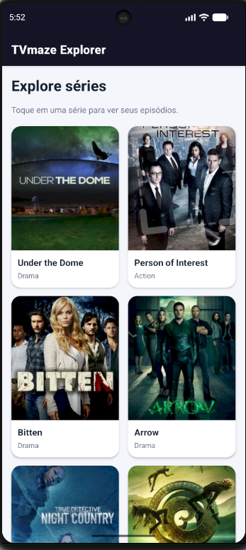
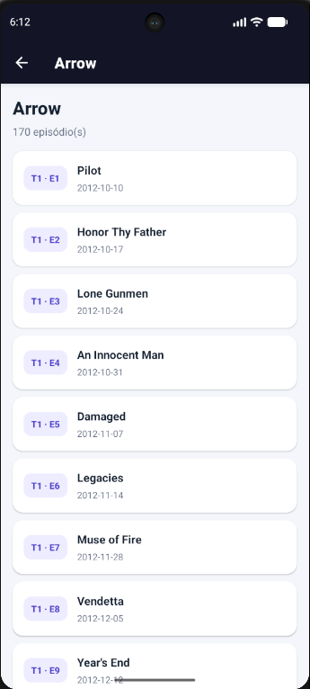

<div align="center">

# 📺 TVmaze Explorer

### Seu próximo episódio começa aqui.

Explore séries, conheça seus detalhes e consulte episódios em uma experiência móvel simples, rápida e intuitiva.

<br>


</div>

---

## 📖 Sobre o projeto

O **TVmaze Explorer** é um aplicativo desenvolvido com React Native e Expo para consultar o catálogo público da TVmaze. Na tela inicial, as séries são apresentadas em uma lista visual. Ao selecionar uma delas, o aplicativo abre uma segunda tela com seus episódios, organizados por temporada e número.

O projeto demonstra conceitos fundamentais do desenvolvimento móvel: navegação entre telas, renderização de listas, chamadas assíncronas a uma API e apresentação de estados de carregamento e erro.

## ✨ Funcionalidades

- **Catálogo de séries:** exibe séries obtidas da API TVmaze com imagem, título e gênero.
- **Detalhes da série:** abre a lista de episódios da série selecionada.
- **Informações dos episódios:** apresenta temporada, número e nome.
- **Navegação em pilha:** usa React Navigation Native Stack para alternar entre listagem e detalhes.
- **Carregamento visível:** mostra um indicador enquanto os dados são buscados.
- **Tratamento de erros:** informa quando uma chamada à API falha.
- **Dados opcionais protegidos:** imagens ou campos ausentes não interrompem o aplicativo.
- **Lista vazia tratada:** informa quando não há episódios disponíveis.

## 🖼️ Capturas de tela

Adicione capturas reais do aplicativo em execução à pasta `screenshots/` e atualize os caminhos, se necessário.

| Catálogo de séries | Episódios da série |
|:---:|:---:|
|  |  |

> As capturas devem ser feitas com o aplicativo aberto no Expo Go ou em um emulador Android. Não use imagens ilustrativas como se fossem capturas reais do app.

## 🧰 Tecnologias e ferramentas

| Tecnologia | Uso |
|---|---|
| [React Native](https://reactnative.dev/) | Construção da interface móvel |
| [Expo](https://expo.dev/) | Ambiente de desenvolvimento e execução |
| [React Navigation](https://reactnavigation.org/) | Navegação entre as telas |
| JavaScript | Lógica e componentes da aplicação |
| [TVmaze API](https://www.tvmaze.com/api) | Dados públicos de séries e episódios |

## 🧠 Conceitos aplicados

- `useState` para controlar dados, carregamento e mensagens de erro.
- `useEffect` para buscar os dados quando cada tela é aberta.
- `fetch` com `async/await` para consultar a API.
- `try/catch/finally` para tratar falhas e finalizar o estado de carregamento.
- `FlatList` para renderizar listas com desempenho adequado.
- `route.params` para enviar o identificador e o nome da série à tela de episódios.
- Verificação de campos opcionais para evitar falhas quando a API retorna valores `null`.

## 🌐 Endpoints utilizados

### Séries

```text
GET https://api.tvmaze.com/shows
